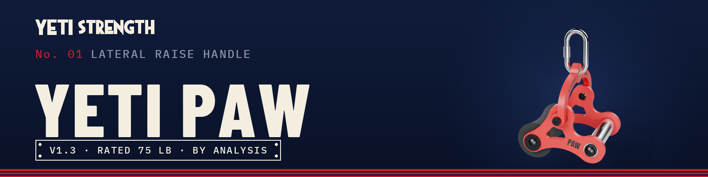
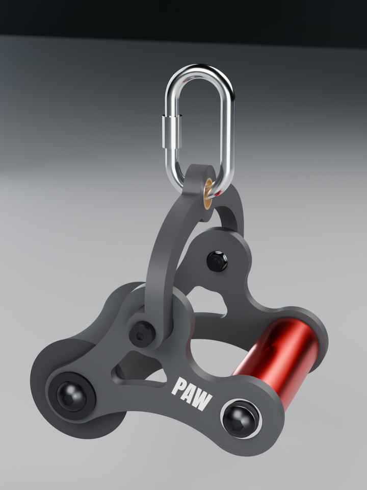

<a href="https://github.com/Schnibbz"><b>← YETI STRENGTH home</b></a> · all gear by <a href="https://github.com/Schnibbz">Schnibbz</a>

A 3D-printed lateral-raise cable attachment. Hold the handle palm-down, let the padded roller rest on your wrist, and clip the swivel yoke to the cable with a carabiner. The side plates and yoke are printed in PETG-CF. The handle is a Rogue H-5 on sealed ball bearings.

**Rated working load: 75 lb (34 kg)** on the cable, for repeated reps. The rating comes from analysis. It has not been physically load-tested. Inspect it before every session, and read [Safety factors](SAFETY-FACTORS.md).

Smart cable machines go far past the rating. A Voltra I, for example, goes up to 200 lb. Keep the setting at or below 75 lb.

Designed by <a href="https://github.com/Schnibbz">Schnibbz</a> · <a href="https://github.com/Schnibbz">More YETI STRENGTH gear</a>

> ## ⚠️ Parts changed in v1.3
> **Two parts are different from v1.2. Buy the new ones: the old ones don't fit the v1.3 files, and the new ones don't fit v1.2 prints.**
>
> | Part | v1.2 (old) | **v1.3 (new)** | Why |
> |---|---|---|---|
> | **Handle bearing** · 2 per handle · both plate variants | FR8-2RS **flanged**, 1/2" × 1-1/8" × 5/16" | **R8-2RS plain** (no flange), same 1/2" × 1-1/8" × 5/16" | The press fit alone holds the bearing; the flange did nothing. Cheaper, and the plate loses its flange pocket and the support it needed. |
> | **Carabiner eye sleeve** · 1 per yoke | uxcell **wrapped** flanged sleeve, 20 × 23 × 10 mm, Ø30 flange | **Solid bronze plain sleeve**, 3/4" bore × 7/8" OD × 1/2" long (McMaster **6391K256**) | The wrapped sleeve pressed in out of round and left the bottom edge of the eye bare plastic where the carabiner bears. The solid sleeve stays round and sits flush on both faces, so the carabiner only touches bronze. |
>
> **Don't mix versions.** v1.3 plates have no flange pocket, so an FR8 won't seat flush. The v1.3 yoke's eye bore is Ø22.39 for the 7/8" sleeve:
> the old 23 mm sleeve won't press in, and the new sleeve would be loose in a v1.2 yoke. Everything else is unchanged.

## Files

**Buy the parts**
- **[Bill of materials](BOM-yeti-paw.md)** ([PDF](BOM-yeti-paw.pdf)) 
  Every part with a link, quantities, and cost per unit and per pair.

**Print the parts.** One YETI PAW is three Bambu Studio projects, one per print. Each one has its own checked settings.
- **[Side plates (.3mf)](https://github.com/Schnibbz/yeti-paw/raw/main/yeti-paw-v1.3-plates-PROJECT.3mf)** yeti-paw-v1.3-plates-PROJECT.3mf 
  Left and right plate together on one bed, with the PAW logo painted. Filament 1 = black PETG-CF, filament 2 = white PETG.
- **[Centered-pivot side plates (.3mf)](https://github.com/Schnibbz/yeti-paw/raw/main/yeti-paw-v1.3-centered-plates-PROJECT.3mf)** yeti-paw-v1.3-centered-plates-PROJECT.3mf · optional variant 
  Print these **instead of** the side plates above for a more balanced feel (see [below](#centered-pivot-variant)). Same
  filaments and settings.
- **[Carabiner yoke (.3mf)](https://github.com/Schnibbz/yeti-paw/raw/main/yeti-paw-v1.3-yoke-PROJECT.3mf)** yeti-paw-v1.3-yoke-PROJECT.3mf 
  The yoke, with YETI STRENGTH painted on. Filament 1 = black PETG-CF, filament 2 = white PETG.
- **[Pad dowel (.3mf)](https://github.com/Schnibbz/yeti-paw/raw/main/yeti-paw-v1.3-dowel-PROJECT.3mf)** yeti-paw-v1.3-dowel-PROJECT.3mf 
  The dowel, standing upright. Black PETG-CF, plus a little PLA (any colour) for the support under its shoulder.
- **[STL files](stl/)** 
  The four parts (plus the centered-pivot plates), already in print orientation, for any other printer or slicer.
- **[Print settings for any printer](PRINT-SETTINGS.md)** 
  Orientation, layers, walls and infill, supports and logo painting.

**Edit or remix it**
- **[STEP files](step/)** 
  The four parts (plus the centered-pivot plates) as CAD solids, posed like the STLs. The yoke STEP carries a YETI STRENGTH engraving that the print files
  don't have. The side plates' 3 mm edge radius is only in the STLs and the 3MF, so
  add it in your CAD if you need it (outline and window, both faces).
- **[Machined aluminum parts (CNC)](CNC-NOTES.md)** 
  STEP files and shop drawings for having the side plates and the yoke machined instead of printed, with ordering and
  finishing notes. Use these files for a machine shop, not the ones in `step/`.

**Put it together**
- **[Assembly sheets (PDF)](yeti-paw-assembly-sheets.pdf)** 
  Exploded views of the handle, yoke (with pivot section) and pad. Build order below.

**Read the research**
- **[Handle research (PDF)](research/yeti-paw-handle-research.pdf)** v2.1 · 34 pages 
  Standard vs centered pivot on four cable movements (lateral raise, bicep curl, Bayesian curl, chest fly): where the load
  sits, resistance curves, peak pad / grip / wrist loads, lifter size, and the hardware checks behind the centered plate.
  Older versions are on the [Releases](https://github.com/Schnibbz/yeti-paw/releases) page.

**Know its limits**
- **[Safety factors](SAFETY-FACTORS.md)** ([PDF](yeti-paw-safety-factors.pdf)) 
  Results at 50, 75 and 100 lb, how they were calculated, and what they don't cover.
- **[Safety factors — centered-pivot plates](SAFETY-FACTORS-CENTERED.md)** ([PDF](yeti-paw-safety-factors-centered.pdf)) 
  The same results for the optional centered-pivot side plates, with a side-by-side comparison to the standard plate.

## Centered-pivot variant

The side plates come in two versions. Both use the same handle, pad, yoke, bearings and hardware, and build the same way;
only the plates differ.

- **Standard plates:** the yoke hooks on below the wrist pad, so the **forearm pad carries most of the load** and your grip
  can relax.
- **Centered-pivot plates:** the yoke hole sits in the middle, between the handle and the pad (an isosceles triangle,
  85 mm to each). The load is **shared more evenly between your hand and your wrist**, closer to how a D-handle or a wrist
  cuff feels.

The exercise itself barely changes. Worked out for a cable lateral raise, the cable follows almost the same path with
either plate. At the hardest point of the rep, a 20 lb cable puts about 17 lb on the pad and 3 lb in the hand with the
standard plates, and about 8 lb on the pad and 12 lb in the hand with the centered ones.

- **Yoke swing (v1.3):** the side between the yoke and the handle is swept concave (R20), so the yoke can follow the cable
  through lateral raises, curls and flies at the stances modeled. With the cable close behind you (a close-stance Bayesian
  curl or fly) it can still reach its stop in the first few degrees of the rep; see the
  [centered-plate safety factors](SAFETY-FACTORS-CENTERED.md).
- **Strength:** the same analysis as the standard plates; side by side, the centered plate matches the standard plate within
  that check. The rating stays 75 lb, and the yoke, not the plate, is the weakest part. Full numbers: [Safety factors — centered-pivot plates](SAFETY-FACTORS-CENTERED.md)
  ([PDF](yeti-paw-safety-factors-centered.pdf)).
- **Files:** the [project](https://github.com/Schnibbz/yeti-paw/raw/main/yeti-paw-v1.3-centered-plates-PROJECT.3mf),
  [STLs](stl/) and [STEPs](step/) (`yeti-paw-v1.3-centered-plate-left/right`). No CNC version yet.

## Before you start

You'll need, beyond the parts in the BOM:
- **A printer with a hardened 0.4 mm nozzle.** Carbon-fibre filament wears out brass nozzles.
- **PETG-CF**, dried. **Never print it in PLA**: PLA creeps under steady load and softens in a hot car.
- **A steel screw-gate carabiner rated 25 kN or more**, with a bar that fits through a 19 mm hole (the bronze eye sleeve's bore). It isn't included.
- **Tools:**
  - hex keys (5 mm and 5/16") and a 13 mm wrench;
  - an inch-pound torque driver and a foot-pound torque wrench;
  - a Ø12 mm drill bit;
  - a bench vise or clamp;
  - fine sandpaper and a deburring tool;
  - a sharp knife or fine saw;
  - a little wax.

  The full list is in the BOM.

## Build order

1. **Clean the printed parts.**
   - Remove all supports, especially inside the bearing bores.
   - Turn a Ø12 mm drill bit by hand through the yoke's two pivot bores to take out the slight sag at the top of each bore.
   - Run a 1/2"-13 bolt in and out of both dowel threads, with a little wax.
2. **Press the bearings into both plates** from the outside face (the PAW side): one plain **R8-2RS** at the handle hole
   (v1.3: no flange; press until it stops on the ledge behind the seat) and one 6000 at the yoke hole. They are firm press fits, so use a vise. No Loctite or CA glue on plastic.
3. **Press the steel sleeves into the yoke**, 1 mm proud of each face. Press the bronze sleeve (v1.3: plain, McMaster 6391K256) through
   the eye until it sits flush with both faces.
4. **Trim the pad** evenly from both ends to 132 mm, off the dowel so the knife can't score it, then slide it onto the dowel.
5. **Fit the yoke to both plates first**, while the inside of each plate is easy to reach. Each side: shoulder bolt from the outside through the yoke sleeve and the 6000 bearing, then the M8 washer
   and nylock on the inside. Tighten to 35 in-lb. Assembly sheet 3b shows the stack.
6. **Fit the dowel and handle between the plates**, PAW facing out on both plates.
   - **Handle**, each end: button-head screw → aluminum spacer → bearing → aluminum spacer → handle. Blue Loctite on these
     screws only; about 10 ft-lb, never more than 15.
   - **Pad**, each end: washer and 2" button-head screw into the dowel. Snug, no Loctite.
7. **Clip on the carabiner** through the bronze eye and lock the screw gate.
8. **Function check before training.**
   - The handle spins freely with no wobble.
   - The yoke swings freely with no play at the pivots.
   - Every screw is tight.
   - Do your first set light, then inspect.

## Version history

Every release is tagged and archived on the [Releases](https://github.com/Schnibbz/yeti-paw/releases) page with its own
files; the full list of changes is in the [CHANGELOG](CHANGELOG.md).

- **v1.3.2** (Oct 2026): yoke eye bore Ø22.39, set by a printed press-fit test with the bronze sleeve (no new parts).
- **v1.3.3** (Oct 2026): yoke lettering on both faces; prime tower moved to the bed centre (cosmetic, no part changes).
- **v1.3.1** (Oct 2026): centered-pivot plates' PAW logo re-centered (cosmetic; no part changes).
- **v1.3** (Oct 2026), **two parts changed** (see the notice at the top):
  - handle bearing: plain **R8-2RS** replaces the flanged FR8, on both plate variants (no flange pocket, one less support area);
  - carabiner eye: a solid bronze sleeve (McMaster 6391K256), flush both faces, replaces the wrapped flanged sleeve;
  - centered-pivot plates: the yoke-to-handle side swept R20 so the yoke follows the cable on curls and flies (at the modeled stances);
  - handle research v2.0 (PDF) added.
- **v1.2** (Oct 2026):
  - new carabiner yoke with a 3 mm radius on every edge, printed at 100 % infill;
  - yoke supports set to sit right against the round pivot bosses, and first-layer advice for its long leg tips;
  - safety factors re-run for the new yoke. The rating stays at 75 lb.
  - YETI STRENGTH painted on the yoke;
  - one Bambu project per print: both side plates on one bed, the yoke, and the dowel;
  - side-plate and yoke settings that stop the edges curling (bed 75 °C, exhaust fan off for the first 3 mm);
  - bearing seats opened up 0.05 mm, after full plates printed tighter than the fit coupons.
- **v1.1** (Oct 2026), first public release:
  - tangent-arc side-plate outline;
  - PAW logo;
  - supports for the bearing seats;
  - safety factors re-run on this geometry.
- **v1.0**: internal prototype, not released.

## License

[CC BY-NC-SA 4.0](LICENSE): print it, share it and remix it with credit to **Schnibbz · YETI STRENGTH**. Don't sell it
or sell prints of it, and share any remix under the same license.

## ⚠️ Disclaimers

**Not professionally engineered.** The Yeti Paw was designed by a hobbyist, not by a licensed or qualified engineer. Any
strength or safety-factor figures are amateur estimates from a simplified computer model. They are not a certified load
rating and come with no guarantee.

**Build and use at your own risk.** You are responsible for printing, assembling, inspecting and using this device. Print
quality, materials, settings and assembly vary, so your parts may be weaker than described. Inspect every part before each
use, and stop using it at the first sign of cracking, play or damage. The designer accepts no liability for injury or
damage arising from building or using it.

**Affiliate links.** The Amazon links in the BOM are affiliate links. If you buy through them, I earn a small commission
on the sale, at no extra cost to you. As an Amazon Associate I earn from qualifying purchases.

 

