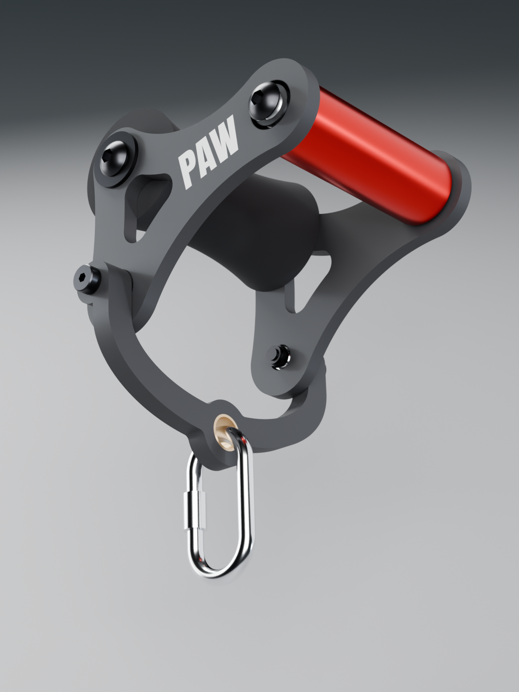

# YETI PAW v1.2 — Lateral Raise Handle

Designed by **Schnibbz** · YETI STRENGTH

A 3D-printed lateral-raise cable attachment. You hold the handle palm-down, the padded roller rests on your wrist, and the
swivel yoke clips to the cable with a carabiner. The side plates and yoke are printed in PETG-CF; the handle is a Rogue H-5
on sealed ball bearings.

**Rated working load: 75 lb (34 kg)** on the cable, for repeated reps. Not physically load-tested; the rating is from
analysis. **Inspect it before every session.** See [Safety factors](SAFETY-FACTORS.md).

 

## Files

**Buy the parts**
- **[Bill of materials](BOM-yeti-paw.md)** ([PDF](BOM-yeti-paw.pdf)) 
  Every part with a link, quantities, and cost per unit and per pair.

**Print the parts**
- **[⬇️ Download the Bambu Studio project (.3mf)](https://github.com/Schnibbz/yeti-paw/raw/main/yeti-paw-v1.2-PROJECT.3mf)** yeti-paw-v1.2-PROJECT.3mf 
  4 build plates (left plate, right plate, yoke, dowel) with all settings, supports and the PAW logo set up. 
  Filament 1 = black PETG-CF, filament 2 = white PETG.
- **[STL files](stl/)** 
  The four parts, already in print orientation, for any other printer or slicer.
- **[Print settings for any printer](PRINT-SETTINGS.md)** 
  Orientation, layers, walls and infill, supports and logo painting.

**Put it together**
- **[Assembly sheets (PDF)](yeti-paw-assembly-sheets.pdf)** 
  Exploded views of the handle, yoke (with pivot section) and pad. Build order below.

**Know its limits**
- **[Safety factors](SAFETY-FACTORS.md)** ([PDF](yeti-paw-safety-factors.pdf)) 
  Results at 50, 75 and 100 lb, how they were calculated, and what they don't cover.

## Before you start

You'll need, beyond the parts in the BOM:
- **A printer with a hardened 0.4 mm nozzle.** Carbon-fibre filament wears out brass nozzles.
- **PETG-CF**, dried. **Never print it in PLA**: PLA creeps under steady load and softens in a hot car.
- **A steel screw-gate carabiner rated 25 kN or more**, with a bar that fits through a 20 mm hole. It isn't included.
- **Tools:**
  - hex keys (5 mm and 5/16") and a 13 mm wrench;
  - an inch-pound torque driver and a foot-pound torque wrench;
  - a Ø12 mm drill bit;
  - a bench vise or clamp;
  - fine sandpaper and a deburring tool;
  - a sharp knife or fine saw;
  - a little wax.

  The full list is in the BOM.

## Build order

1. **Clean the printed parts.**
   - Remove all supports, especially inside the bearing bores.
   - Turn a Ø12 mm drill bit by hand through the yoke's two pivot bores to take out the slight sag at the top of each bore.
   - Run a 1/2"-13 bolt in and out of both dowel threads, with a little wax.
2. **Press the bearings into both plates** from the outside face (the PAW side): one flanged FR8 at the handle hole and one
   6000 at the yoke hole. They are firm press fits, so use a vise. No Loctite or CA glue on plastic.
3. **Press the steel sleeves into the yoke**, 1 mm proud of each face. Press the bronze sleeve into the eye, flange up in its
   pocket.
4. **Trim the pad** evenly from both ends to 132 mm, off the dowel so the knife can't score it, then slide it onto the dowel.
5. **Fit the yoke to both plates first**, while the inside of each plate is easy to reach. Each side: shoulder bolt from the outside through the yoke sleeve and the 6000 bearing, then the M8 washer
   and nylock on the inside. Tighten to 35 in-lb. Assembly sheet 3b shows the stack.
6. **Fit the dowel and handle between the plates**, PAW facing out on both plates.
   - **Handle**, each end: button-head screw → aluminium spacer → bearing → aluminium spacer → handle. Blue Loctite on these
     screws only; about 10 ft-lb, never more than 15.
   - **Pad**, each end: washer and 2" button-head screw into the dowel. Snug, no Loctite.
7. **Clip on the carabiner** through the bronze eye and lock the screw gate.
8. **Function check before training.**
   - The handle spins freely with no wobble.
   - The yoke swings freely with no play at the pivots.
   - Every screw is tight.
   - Do your first set light, then inspect.

## Version history

- **v1.2** (Oct 2026):
  - new carabiner yoke with a 3 mm radius on every edge, printed at 100 % infill;
  - yoke supports set to sit right against the round pivot bosses, and first-layer advice for its long leg tips;
  - safety factors re-run for the new yoke. The rating stays at 75 lb.
- **v1.1** (Oct 2026), first public release:
  - tangent-arc side-plate outline;
  - PAW logo;
  - supports for the bearing seats;
  - safety factors re-run on this geometry.
- **v1.0**: internal prototype, not released.

## License

[CC BY-NC-SA 4.0](LICENSE): print it, share it and remix it with credit to **Schnibbz · YETI STRENGTH**. Don't sell it
or sell prints of it, and share any remix under the same license.

## ⚠️ Disclaimers

**Not professionally engineered.** The Yeti Paw was designed by a hobbyist, not by a licensed or qualified engineer. Any
strength or safety-factor figures are amateur estimates from a simplified computer model. They are not a certified load
rating and come with no guarantee.

**Build and use at your own risk.** You are responsible for printing, assembling, inspecting and using this device. Print
quality, materials, settings and assembly vary, so your parts may be weaker than described. Inspect every part before each
use, and stop using it at the first sign of cracking, play or damage. The designer accepts no liability for injury or
damage arising from building or using it.

**Affiliate links.** The Amazon links in the BOM are affiliate links. If you buy through them, I earn a small commission
on the sale, at no extra cost to you. As an Amazon Associate I earn from qualifying purchases.
